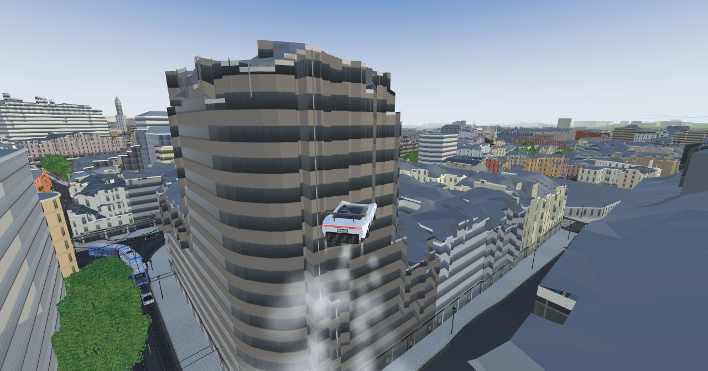
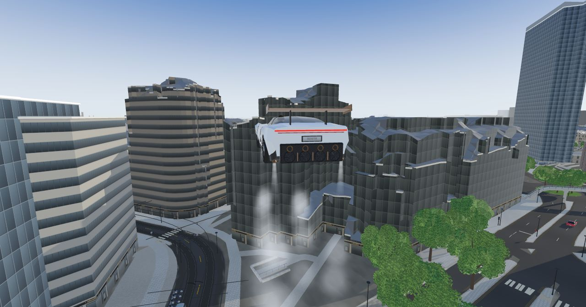
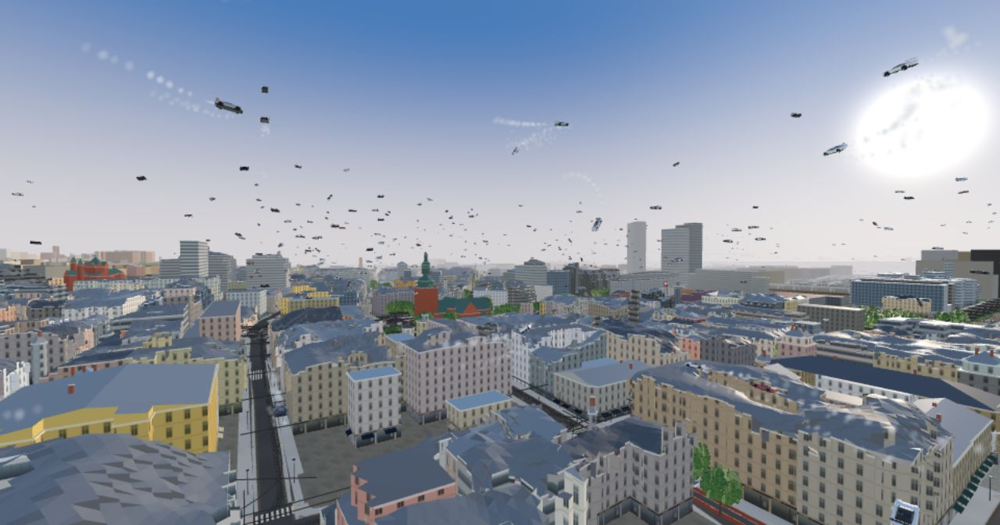

# Grand Theft City

*Created by Martin Truong at [Sloyd](https://www.sloyd.ai).*

A GTA-style open world in your browser, built from a real city's open map data: its actual
streets, buildings, parks, tram lines, trees and coastline. Drive, steal cars, outrun the police,
take jobs across town, and fly a Tesla Roadster over the rooftops while hundreds of others take
off, loop and land around you.

It comes with **Oslo** ready to play. Any other city is one config file and one command away,
or one sentence to an AI agent with the included **build-city skill**.



| | |
|---|---|
|  |  |

## Play Oslo

Needs [Node.js](https://nodejs.org) 20 or newer and git.

```sh
git clone https://github.com/Sloydai/grand-theft-city.git
cd grand-theft-city
npm install
bash tools/get-city-data.sh oslo   # the ready-built map, about 70 MB
node tools/serve.mjs 8777
```

Open http://localhost:8777 and click to play. A desktop browser with a graphics card works best.

## Make your own city

### With an AI agent (Claude Code)

Install the skill, then ask for the game you want, e.g. *"Make Grand Theft Hanoi around Hoan
Kiem Lake"* or *"Build the game for Lisbon and call it Lisboa Run"*:

```sh
claude plugin marketplace add Sloydai/grand-theft-city
claude plugin install grand-theft-city@grand-theft-city
```

The agent clones this repository, finds the city's coordinates, writes its config, builds the
map and starts the game (`/grand-theft-city:build-city` runs it directly). The skill is a plain
[Agent Skills](https://agentskills.io) file,
[`plugins/grand-theft-city/skills/build-city/SKILL.md`](plugins/grand-theft-city/skills/build-city/SKILL.md),
so other agents can follow it too.

### By hand


1. Copy the Oslo config and edit it: `cp -r cities/oslo cities/<id>` (`<id>`: lower case,
   letters, digits and dashes), then change `cities/<id>/city.json` (fields below).
2. Build it: `bash tools/build-city.sh <id>`. It downloads OpenStreetMap from the public
   Overpass servers, the elevation and the optional extras into `data/<id>/`, then runs every
   processing step. The first build takes 10 to 30 minutes, mostly waiting on Overpass;
   `--skip-download` reruns only the processing.
3. Play it: `node tools/serve.mjs 8777`, then http://localhost:8777/?city=<id>.
4. Share it: in your fork, `bash tools/release-city-data.sh <id>` publishes the built game
   files as the GitHub release `<id>-data` (needs the GitHub CLI); others get them with
   `bash tools/get-city-data.sh <id>`.

| Field | |
|---|---|
| `name` | The city's name, shown next to street names. |
| `title` | Optional. The game's name (default "Grand Theft <name>"); its last word is drawn in colour. |
| `box` | The map area, `minLat`, `minLon`, `maxLat`, `maxLon`. Oslo's is about 5 × 6.3 km; much larger areas take long to download and need more memory. |
| `origin` | `lat`, `lon` of game coordinates 0, 0. Pick the middle of the box. |
| `centre` | Optional. Where sky traffic is densest (default: the origin). |
| `spawn` | Optional. The start point, `lat`, `lon`, and `face` (`lat`, `lon` to look towards). Default: the centre, beside the nearest street. |
| `station` | Optional. The main railway station, where trains stop. |
| `focus` | Optional. A small box (1 to 2 km) where every OSM feature is downloaded for extra detail (stairs, quays, paths); facade photos are also looked for there. |
| `elevation` | `"kartverket"`: Norway only, 1 m laser grids, with measured building and bridge heights. `"global"`: anywhere, from AWS Terrain Tiles (mostly 30 m SRTM, finer where countries publish more). `"flat"`: no terrain. |
| `elevationBase` | Optional, metres (default 0, sea level). Heights are stored within ±327 m of it, so a city on high ground sets a number near its lowest point, or `"min"`. |
| `nvdb` | Optional, `true` in Norway: surveyed kerbs, crossings and road markings from Statens vegvesen. |
| `gbfs` | Optional. The base URL of the city's bike-share GBFS feed (without `/station_information.json`); many cities are listed at https://github.com/MobilityData/gbfs/blob/master/systems.csv. |

What to expect elsewhere:

- The game is built for a city by the sea: its water level is sea level (or `elevationBase`).
  Rivers and lakes higher up are drawn at that level.
- Street detail (lanes, sidewalks, crossings, kerbs) comes from the OSM tags, so it is as good
  as the city's mapping; NVDB adds surveyed detail only in Norway.
- Building heights come from OSM's `height` and `building:levels`, else an estimate;
  measured heights need Kartverket.
- Oslo's own touches (landmark colours by name, the tiger on Jernbanetorget, the Akershus
  walls, Karl Johan's footfall) simply don't appear elsewhere.
- Credit the sources of what you build: OpenStreetMap contributors (ODbL) always; Kartverket
  (CC BY 4.0) or "Terrain Tiles: Mapzen and data sources"
  (https://github.com/tilezen/joerd/blob/master/docs/attribution.md); NVDB (NLOD 2.0); and
  the bike feed's own licence.

### Data layout

`data/<id>/` holds a city's raw downloads (`*-raw.json`, elevation tiles) and the files the
game loads: `world.json` (the map in game metres, from `tools/preprocess.cjs`), `terrain.bin`
and `surface.bin` with `terrain.json` (2 m height grids), `streets.json`, `street-mesh/`
(prebuilt street surfaces), and optionally `bikes.json` and `bridge-heights.json`. It is not
in git. The tools take the city from `CITY` (default `oslo`), through `tools/city.cjs`.


### Playable zips

On macOS, `CITY=<id> bash tools/package.sh` turns a built city into `dist/<Title>.zip` (plays
offline, with Mac and Windows launchers) and `dist/<Title>-web.zip` (for itch.io). The
launchers' README and credits in `dist-template/` are written for Oslo: edit them for your city.

## Controls


| Key | Action |
|---|---|
| WASD | Move / drive |
| Mouse | Look |
| Click | Shoot (on foot) |
| F | Enter, steal, or exit a car |
| Shift | Sprint / fire the Roadster's thrusters |
| G | Fly or land (Tesla Roadster) |
| Space / E, C / Q | Climb, descend (flying) |
| Space | Jump / handbrake |
| H | Horn |
| M | Mute |

## How it works

Each city's map is built ahead of time by the scripts in `tools/` (orchestrated by
`tools/build-city.sh`): OpenStreetMap features become buildings with real roof shapes, street
surfaces with kerbs and markings, a smoothed drive terrain, tram and bus routes, signals,
trees and stops, all in metres round the city's origin. The game (`game.js`, plain ES modules on
[three.js](https://threejs.org), no build step) streams them in 300 m tiles round the camera.
Street props and car bodies are models made with [Sloyd](https://www.sloyd.ai); trams, trains and
the Roadster are built in code. The full story is in
[docs/TECHNICAL-NOTES.md](docs/TECHNICAL-NOTES.md).

Making new models from text prompts with the Sloyd API: put your keys in `.env` (see
`.env.example`) and run `node tools/sloyd-generate.mjs`.

## Licence and credits

Code and models: MIT with an attribution requirement (see [LICENSE](LICENSE)). Every copy or
game built with it must keep the on-screen credit "Created by Martin Truong" (bottom-right); to
remove or change it, ask Martin Truong first at martin@sloyd.ai. Third-party code, the map data
sources you must credit when sharing a built city, and trademarks are listed in
[NOTICE.md](NOTICE.md).

Map data © OpenStreetMap contributors (ODbL). A fan-made game, not affiliated with Rockstar
Games or Tesla, Inc. Inspired by Lasse Saari's GTA-style Helsinki and built on ideas from
[Worldhood](https://github.com/worldhood/worldhood).
